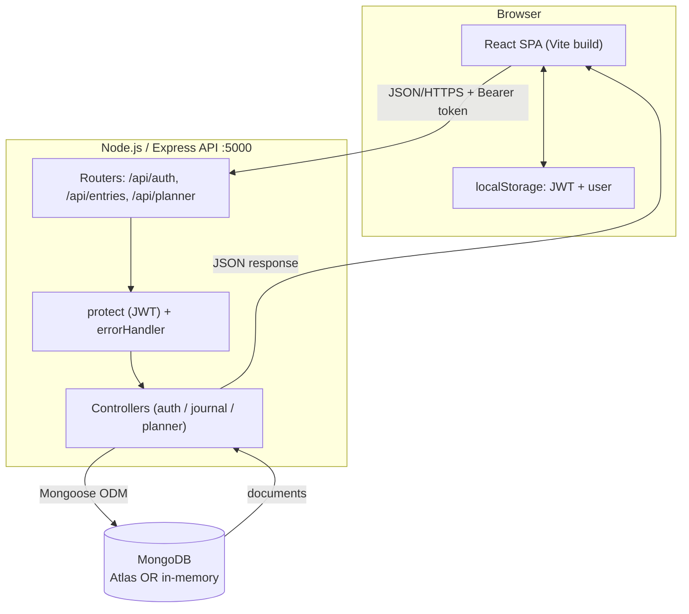
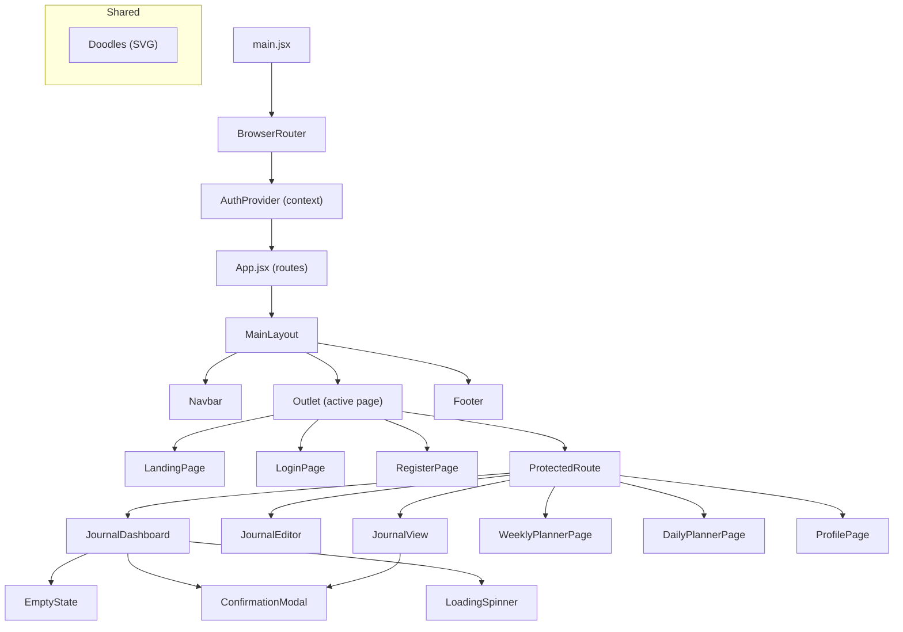
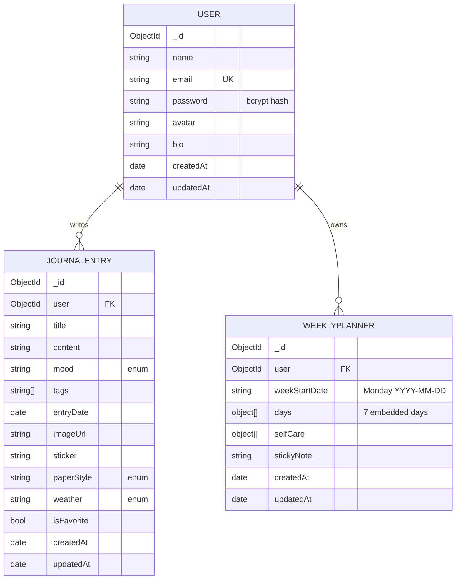
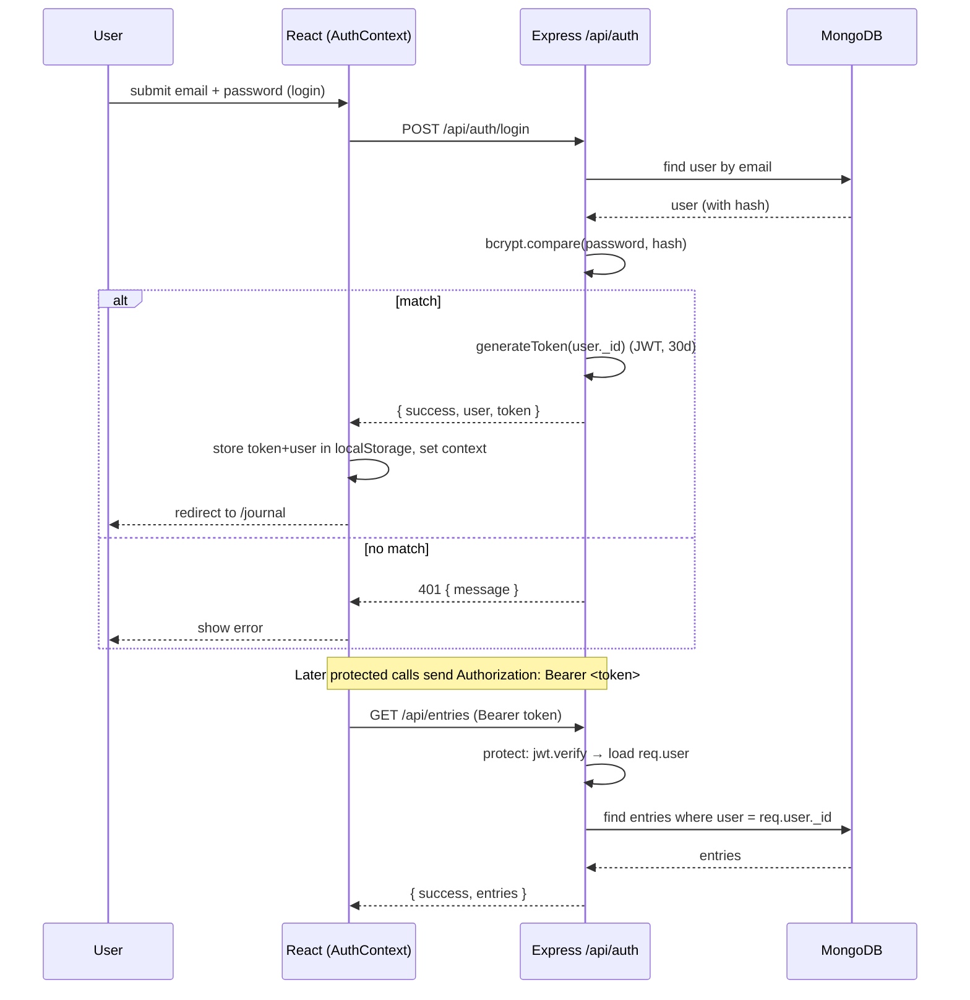

# SYSTEM_ARCHITECTURE.md — TODO: fix my life

## 1. High-Level Architecture

The app is a **decoupled MERN SPA + REST API**:

- A **React single-page app** (Vite build) runs entirely in the browser. It owns all UI, routing (client-side via React Router), and local auth state.
- An **Express REST API** owns all business logic, validation, authorization, and persistence.
- They communicate over **JSON/HTTP** on `/api/*`. In development, Vite proxies `/api` to `http://localhost:5000`; in production you'd serve the built static files and point them at the deployed API.
- **MongoDB** (Atlas or an embedded in-memory server) is the single source of truth.
- Auth is **stateless JWT**: the server holds no sessions; the browser stores the token in `localStorage` and sends it as a Bearer header.



## 2. Technology Stack and Why Each Piece Is Used

| Layer | Technology | Why |
|---|---|---|
| UI library | **React 18** | Component model + hooks for the interactive editor/planner. |
| Build tool | **Vite 5** | Fast dev server + HMR; builds a small static bundle. |
| Routing | **React Router DOM 6** | Client-side routes incl. dynamic (`/journal/:id`, `/planner/:date`) and guarded routes. |
| Styling | **Tailwind CSS 3** | Utility classes + a custom `cozy` palette drive the whole aesthetic without hand-written CSS files (plus a small `index.css` for paper/washi textures). |
| HTTP | **Axios** | Interceptors cleanly attach the JWT and handle 401 globally. |
| Icons/FX | **lucide-react**, **canvas-confetti** | Line icons + celebratory confetti. |
| Runtime | **Node.js (ESM)** | JavaScript on the server; `"type":"module"` for `import` syntax. |
| API framework | **Express 4** | Minimal routing + middleware pipeline. |
| ODM | **Mongoose 8** | Schemas, validation, hooks (password hashing), subdocuments (planner days/tasks), indexes. |
| Database | **MongoDB** | Document model fits the embedded weekly-planner structure naturally. |
| Dev DB | **mongodb-memory-server** | Zero-config embedded DB so the app runs without installing Mongo. |
| Auth | **jsonwebtoken** + **bcryptjs** | Stateless tokens + salted password hashing. |
| Misc | **cors**, **dotenv** | Cross-origin access + env configuration. |

## 3. Frontend Component Architecture



## 4. Backend Architecture

The request pipeline for a protected endpoint:

```
HTTP request
  → express.json() body parsing + CORS
  → Router match (e.g. plannerRoutes)
  → protect middleware  (verify JWT → load req.user, else 401)
  → controller          (validate input, ownership check, DB op via Mongoose)
  → res.json(...)        OR  next(error)
  → errorHandler         (format uncaught/forwarded errors as JSON)
```

Layering: **routes** (URL mapping) → **middleware** (auth, errors) → **controllers** (logic) → **models** (schema + persistence). Controllers never build SQL/queries by hand beyond Mongoose query objects, and never see raw `req`/`res` concerns like token parsing (that's middleware).

## 5. Database Architecture & Schema

Three collections: `users`, `journalentries`, `weeklyplanners`. See `DATABASE_AND_API_GUIDE.md` for field-level detail.



`days[]` and each day's `tasks[]` are **embedded subdocuments**, not separate collections. This is the key schema decision behind weekly/daily sync.

## 6. API Architecture

- **Base path:** `/api`.
- **Resource groups:** `/auth`, `/entries`, `/planner`.
- **Auth model:** stateless JWT, 30-day expiry, Bearer header.
- **Response convention:** every response is JSON with a `success` boolean plus a payload (`user`, `entry`, `entries`, `planner`, `day`, …) or a `message` on error.
- **Status codes used:** 200 OK, 201 Created, 400 validation, 401 unauthenticated, 403 unauthorized (ownership), 404 not found, 500 server error.

Full endpoint table is in `DATABASE_AND_API_GUIDE.md`.

## 7. Authentication Flow



## 8. Key Feature Sequence — Weekly/Daily Planner Synchronization

```mermaid
sequenceDiagram
    participant Day as DailyPlannerPage
    participant API as plannerAPI (axios)
    participant S as plannerController
    participant DB as MongoDB (WeeklyPlanner)
    participant Week as WeeklyPlannerPage

    Day->>API: PATCH /planner/day/2026-10-11/task/:id/toggle
    API->>S: toggleTask
    S->>S: getMondayOfWeek("2026-10-11") → "2026-10-05"
    S->>DB: findOne({ user, weekStartDate:"2026-10-05" })
    DB-->>S: weekly document (7 days embedded)
    S->>S: day = days.find(date==="2026-10-11"); task.completed = !completed
    S->>DB: planner.save()
    S-->>API: { success, task, day }
    Note over Week: When the weekly page loads the same week...
    Week->>API: GET /planner/week/2026-10-11
    API->>S: getWeeklyPlanner
    S->>DB: findOne same document
    DB-->>S: SAME document (already updated)
    S-->>Week: planner → Sunday shows the toggled task
```

Because both views resolve to the **same `weekStartDate` document**, there is no separate synchronization mechanism — consistency is a property of the data model.

## 9. Design Decisions and Trade-offs

| Decision | Benefit | Trade-off |
|---|---|---|
| Embed 7 days + tasks in one weekly document | Automatic weekly/daily consistency; one round-trip to load a week | A week document grows with tasks; very large weeks approach Mongo's 16 MB doc limit (not realistic here). Concurrent edits to the same week can race (last-write-wins). |
| Store dates as `YYYY-MM-DD` strings | Easy exact-match lookups, avoids timezone drift on day keys | No native date range queries on planner days. |
| JWT in `localStorage` | Simple, survives refresh, no server session store | Vulnerable to XSS token theft (an httpOnly cookie would be safer). |
| In-memory Mongo fallback | Instant local dev, no install | Data is wiped on restart; must set `MONGO_URI` for persistence. |
| `upsert on read` for planners | The UI never has to "create a week" first | A GET has a write side effect (creates the week). |
| `success` flag in every response | Uniform client handling | Slightly redundant with HTTP status codes. |
| CORS `origin: '*'` | Easy cross-origin dev | Too permissive for production — should be locked to the real frontend origin. |
